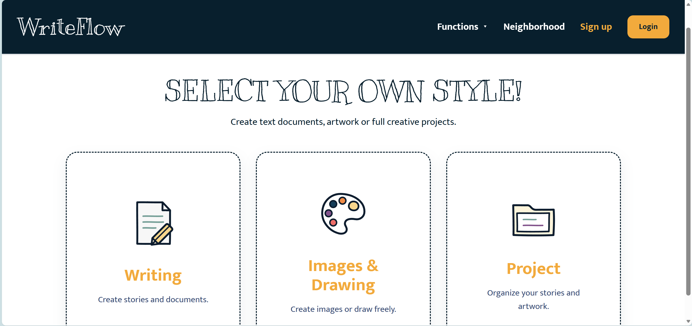

# WriteFlow

WriteFlow is a creative publishing application that brings rich-text writing and canvas drawing into one project. Creators can organize chapters, characters, scenes, and covers, publish their work, and review collaborators' proposed changes.

## Screenshots

### Homepage



## Features

- **Writing and drawing:** rich-text editing with image uploads; a drawing canvas with brushes, shapes, image import, and PNG export.
- **Projects:** group written and visual works by role and publish projects or individual works.
- **Community:** search by author, tags, and keywords; filter by content type; like, bookmark, comment, and follow creators.
- **Accounts:** JWT authentication, bcrypt password hashing, user profiles, avatars, and server-side access checks.
- **Reviewed collaboration:** private drafts, submission previews, owner approval or rejection with comments, and version checks that reject outdated submissions.
- **Live notifications:** Socket.IO reports presence, saved updates, submissions, and review decisions.

Collaboration is based on submitting and reviewing changes. It does not provide simultaneous character-by-character editing or automatic conflict merging.

## Technology

| Layer | Tools |
| --- | --- |
| Frontend | React, TypeScript, Vite, Tailwind CSS |
| Editors | Slate, Fabric.js |
| Backend | Node.js, Express, TypeScript |
| Database | MySQL, mysql2 |
| Authentication | JSON Web Tokens, bcrypt |
| Notifications | Socket.IO |
| Uploads | Multer and local filesystem storage |

## Run locally from GitHub

### 1. Prerequisites

Install:

- Node.js 22.12 or later within the Node.js 22 release line, with npm.
- MySQL 8.0.16 or later, with the database service running.
- Git, or download the repository as a ZIP.
- MySQL Workbench or the MySQL command-line client.

Two terminals are required: one for the backend and one for the frontend.

> **Fresh installations:** run `server/database/schema.sql` in MySQL Workbench as described below. It includes all 15 tables and the publication features; no sample accounts or user data are included.

### 2. Download the code

```powershell
git clone https://github.com/kayshen18/writeflow.git
cd writeflow
```

### 3. Install dependencies

Install frontend dependencies:

```powershell
npm ci
```

Install backend dependencies:

```powershell
cd server
npm ci
cd ..
```

### 4. Set up MySQL

For a new local installation, run the following in MySQL Workbench using an administrator account. Replace the password placeholder with your own local password.

```sql
CREATE DATABASE IF NOT EXISTS writeflow_db
  CHARACTER SET utf8mb4
  COLLATE utf8mb4_unicode_ci;

CREATE USER IF NOT EXISTS 'writeflow_app'@'localhost'
  IDENTIFIED BY 'REPLACE_WITH_YOUR_LOCAL_PASSWORD';

GRANT SELECT, INSERT, UPDATE, DELETE
  ON writeflow_db.*
  TO 'writeflow_app'@'localhost';
```

### 5. Configure the backend

From the repository root:

```powershell
Copy-Item server/.env.example server/.env
```

Skip this copy if `server/.env` already exists, to preserve your configuration. Edit `server/.env`:

```dotenv
PORT=3000
DB_HOST=localhost
DB_PORT=3306
DB_USER=writeflow_app
DB_PASSWORD=REPLACE_WITH_YOUR_LOCAL_PASSWORD
DB_NAME=writeflow_db
JWT_SECRET=REPLACE_WITH_A_LONG_RANDOM_SECRET
```

Generate a JWT secret locally with:

```powershell
node -e "console.log(require('node:crypto').randomBytes(32).toString('hex'))"
```

Paste the generated value into `JWT_SECRET`. Do not commit your actual `.env` file.

The current frontend uses `http://localhost:3000` for API and Socket.IO connections. The backend allows the frontend origin `http://localhost:5173`. Use these addresses for the initial setup; changing ports requires updating the corresponding URLs and CORS settings.

Supabase credentials are not required by the current implementation.

### 6. Start the backend

In terminal 1, from the repository root:

```powershell
cd server
npm run dev
```

Expected startup message:

```text
WriteFlow API is running at http://localhost:3000
```

### 7. Start the frontend

In terminal 2, from the repository root:

```powershell
npm run dev -- --port 5173 --strictPort
```

Open [WriteFlow](http://localhost:5173) in your browser. Keep both terminals running. Press `Ctrl+C` in each terminal to stop the application.


## Database schema

`server/database/schema.sql` is a structure-only snapshot of the working database. It includes:

- Accounts and content: `users`, `works`, `projects`, `project_items`.
- Work interactions: `comments`, `work_likes`, `work_bookmarks`, `user_follows`.
- Collaboration: `work_collaborators`, `work_drafts`, `work_change_requests`, `notifications`.
- Project interactions: `project_comments`, `project_likes`, `project_bookmarks`.

It preserves primary keys, indexes, foreign keys, defaults, review states, and version fields. It contains no user data and does not create a default account or project.

This is a **fresh-install script**, not an upgrade or reset script. It contains no `DROP TABLE` or data deletion statements. Do not execute it against your existing populated installation. MySQL DDL is not rolled back as a single transaction: if an import fails partway, inspect the error and partially created tables before retrying.

`publish-project.sql` is a historical incremental migration. Its changes are already included in `schema.sql`; new installations should run only `schema.sql`.

The schema was checked against the running database's table definitions and foreign-key dependency order. A separate empty-database import and end-to-end first-run test have not yet been performed.

## Project structure

```text
writeflow/
├── src/
│   ├── pages/          # Editors, projects, community, and account pages
│   ├── components/     # Shared UI, review panels, and notifications
│   ├── lib/            # HTTP API and Socket.IO clients
│   ├── assets/         # Fonts and SVG icons
│   ├── theme.css       # Shared interface colors
│   └── index.css       # Global styles
├── server/
│   ├── src/index.ts    # API routes, access checks, and socket events
│   ├── database/       # Complete schema and historical migration
│   ├── .env.example    # Backend configuration template
│   └── uploads/        # Runtime files; created automatically, not committed
└── package.json
```

Work content and metadata are stored in MySQL. Uploaded images are stored under `server/uploads/`; copying the source code does not copy these files or the database.

## Available commands

| Directory | Command | Purpose |
| --- | --- | --- |
| Repository root | `npm run dev` | Start the frontend development server |
| Repository root | `npm run build` | Type-check and build the frontend |
| Repository root | `npm run lint` | Run frontend lint checks |
| Repository root | `npm run preview` | Preview the frontend build |
| `server/` | `npm run dev` | Start the backend with file watching |
| `server/` | `npm start` | Start the backend without file watching |

The frontend preview command does not start the backend or MySQL. Its default origin also differs from the currently allowed development origin.

## Troubleshooting

| Problem | What to check |
| --- | --- |
| `Access denied for user` | Match the MySQL username, password, host, and permissions to `server/.env`. |
| `Unknown database 'writeflow_db'` | Create the database and check `DB_NAME`. |
| Missing-table errors | Import the complete database schema; the connection check alone does not create tables. |
| `Failed to fetch` | Keep the backend running on port 3000 and open the frontend at `http://localhost:5173`. |
| Port 5173 is occupied | Stop the process using that port before restarting the frontend. |
| JWT secret error | Set `JWT_SECRET` in `server/.env` and restart the backend from `server/`. |
| Images are missing | Check that the backend is running and the referenced files exist in `server/uploads/`. |
| Both test windows use one account | Use different browsers or separate private sessions. |

## Scope

WriteFlow is a local development project. A public deployment would require separate hosting for the backend and MySQL, configured URLs and CORS, and persistent storage for uploads. GitHub Pages alone cannot run this backend or database.
